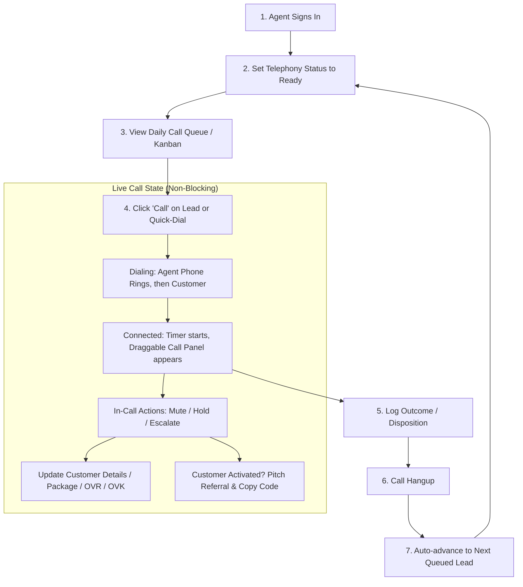
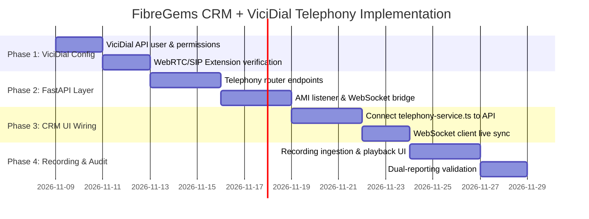

# FibreGems CRM — Agent Telephony & ViciDial Integration Architecture

> **Comprehensive Guide:** Agent Operations, ViciDial Architecture, FastAPI Endpoints, and Phased Implementation Plan  
> **Target Environment:** FibreGems CRM (React / TanStack / Tailwind) + FastAPI Middleware + PostgreSQL + ViciDial / Asterisk PBX

---

## 1. Executive Summary & Architecture Topology

FibreGems CRM is built for high-velocity telecom outbound sales, lead qualification, and after-sales support (FTTH - Vuma Reach, etc.). The agent UI provides a seamless workflow: agents manage their daily pipeline queue, place click-to-dial phone calls, take notes, capture OVR/OVK order numbers, handle EasyPay collections, pitch referral programs to activated customers, and log dispositions without ever leaving the CRM interface.

### High-Level System Architecture

```
┌────────────────────────────────────────────────────────────────────────┐
│                   Agent Browser (React + TanStack Start)               │
│                                                                        │
│  ┌──────────────────────┐  ┌────────────────────────────────────────┐  │
│  │ Draggable HUD Panel  │  │ Slide-in Customer Drawer (non-blocking)│  │
│  │  - Call duration     │  │  - Contact & Address                   │  │
│  │  - Live Mute / Hold  │  │  - Package & EasyPay / OVR / OVK       │  │
│  │  - Hangup button     │  │  - Referral Pitch & Code Copy          │  │
│  │  - Referral Card     │  │  - Outcome & Dispositions              │  │
│  └──────────────────────┘  └────────────────────────────────────────┘  │
│  ┌──────────────────────────────────────────────────────────────────┐  │
│  │ Fixed Softphone Bar: Ready / Break / Dialpad / Outcome & Next    │  │
│  └──────────────────────────────────────────────────────────────────┘  │
└───────────────────────────┬────────────────────────────────────────────┘
                            │
              REST API & WebSocket (/api/v1)
                            │
┌───────────────────────────▼────────────────────────────────────────────┐
│                  FastAPI Backend Middleware (Python)                   │
│                                                                        │
│  ┌──────────────────────────┐     ┌──────────────────────────────────┐ │
│  │ Telephony Router         │     │ ViciDial Client Wrapper          │ │
│  │  - /telephony/dial       │     │  - agent_api.php                 │ │
│  │  - /telephony/hangup     │◄───►│  - non_agent_api.php             │ │
│  │  - /telephony/status     │     │  - Asterisk AMI Listener (:5038) │ │
│  │  - /telephony/ws/{agent} │     │  - Recording Ingestion Engine    │ │
│  └──────────────────────────┘     └──────────────────────────────────┘ │
└─────────────┬───────────────────────────────────────────┬──────────────┘
              │                                           │
       SQL Queries (AsyncPG)                        HTTP / AMI Socket
              │                                           │
┌─────────────▼──────────────┐             ┌──────────────▼──────────────┐
│  PostgreSQL Database (RDS) │             │    ViciDial / Asterisk PBX   │
│   - customers (referrals)  │             │   - MariaDB (vicidial_log)   │
│   - orders (ovr/ovk)       │             │   - Asterisk SIP Trunking    │
│   - payments (easypay)     │             │   - Call Audio Recordings    │
│   - activities & call_logs │             │   - Agent WebRTC / SIP Phone │
└────────────────────────────┘             └─────────────────────────────┘
```

---

## 2. How the Agent Side Works in FibreGems CRM

The agent side is structured around high productivity, zero screen switching, and non-blocking interaction.

### 2.1 The Agent Lifecycle



### 2.2 Core UI Telephony Components

1. **`SoftphoneBar.tsx` (Persistent Bottom Softphone)**:
   - Anchored at the bottom of the screen at all times.
   - Houses the Agent Status Pill (`Ready` in green, `Dialing...`, `On Call` in red, `Break` with sub-codes like `LUNCH`, `TEA`, `MEETING`).
   - Quick Dial button to open the phone dialer.
   - Post-call disposition selector (`Save & Next`) to instantly jump to the next prioritized lead.

2. **`ActiveCallPanel.tsx` (Draggable Live Call HUD)**:
   - Floating component (`z-[9999]`) that opens automatically the instant a call is initiated.
   - Built with pointer capture dragging (`onPointerDown`, `onPointerMove`, `onPointerUp`) so agents can freely reposition it anywhere on screen.
   - Displays real-time call duration timer, live `REC` recording indicator, customer name, and 1-click phone copy.
   - Provides instant call controls: **Mute / Unmute**, **Hold / Resume**, **Escalate to Supervisor**, **Log Outcome**, and **Hang Up**.
   - **Activated Referral Card**: When an agent is on a call with an activated customer, the panel surfaces a prominent referral pitch banner with the customer's unique referral code, copy button, and a **`+ Add Referral Lead`** shortcut.

3. **`CustomerDrawer.tsx` (Slide-In Lead Workspace)**:
   - Slide-in side drawer rendering full lead intelligence.
   - Configured with `modal={false}`, `hideOverlay={true}`, and `pointer-events-auto` so it **does not block the live call HUD** from being moved or clicked.
   - **Contact Tab**: Full name, primary cell, alternate number, email, address, and the customer's unique referral code.
   - **Package Tab**: Package dropdown (`Vuma Reach 10/20/50/100Mbps`), payment type, EasyPay cycle/expiry, and **OVR Number / OVK Number** fields synced with the `orders` database table.
   - **Outcome Tab**: Quick disposition logger (`CALLBACK`, `PAYMENT_PROMISED`, `SALE`, `ACTIVATED`, `NI`, `DNC`) with date picker and notes.
   - **Timeline Tab**: Chronological audit trail of all previous touchpoints, agent notes, call outcomes, and Agility sync logs.

4. **`OutcomeDialog.tsx` & `LeadForm.tsx` (Non-Blocking Modals)**:
   - Popups configure `modal={false}` and `hideOverlay={true}` with `onInteractOutside={(e) => e.preventDefault()}`.
   - This ensures agents can fill out forms or register referrals while actively speaking with the customer and moving the live call widget around their screen.

5. **Outcome Awareness on Hangup**:
   - The telephony state tracks `outcomeLoggedForCall: boolean`.
   - If an agent already logged the outcome while on the call, clicking **Hang up** terminates the call and displays `"Call ended."` without badgering them to log an outcome.
   - If the call is terminated without a disposition, the CRM prompts: `"Call ended. Choose an outcome to continue."`

---

## 3. How FibreGems CRM Connects to ViciDial

ViciDial is an Asterisk-based contact center engine. To achieve a seamless integration without security hazards or CORS issues, FibreGems CRM communicates through the **FastAPI Middleware Layer**.

```
┌─────────────────────┐        HTTP / JSON       ┌──────────────────────┐
│ FibreGems React CRM │ ◄──────────────────────► │   FastAPI Backend    │
│ (Agent Browser)     │        WebSockets        │   (Port 8000)        │
└─────────────────────┘                          └──────────┬───────────┘
                                                            │
                     ┌──────────────────────────────────────┴──────────────────────────────────────┐
                     │                                                                             │
                     ▼ HTTP GET/POST                                                               ▼ TCP Socket (:5038)
       ┌───────────────────────────┐                                                 ┌───────────────────────────┐
       │   ViciDial Web APIs       │                                                 │   Asterisk Manager (AMI)  │
       │  /agc/api.php             │                                                 │                           │
       │  /vicidial/non_agent_api  │                                                 │  Event: Hangup            │
       │   - external_dial         │                                                 │  Event: BridgeEnter       │
       │   - external_hangup       │                                                 │  Event: DialState         │
       │   - external_pause        │                                                 │  Event: VarSet (Recording)│
       │   - dispo                 │                                                 │                           │
       └───────────────────────────┘                                                 └───────────────────────────┘
```

### 3.1 Recommended Architecture: Backend Middleware Proxy

**Do not connect the browser directly to ViciDial.** Connecting directly creates 3 major problems:
1. **CORS & Mixed-Content**: ViciDial standard installations lack CORS headers and often run on internal HTTP.
2. **Credential Exposure**: ViciDial API credentials (`api_user`, `api_pass`) would be exposed in browser source code.
3. **Database Desynchronization**: If the browser directly commands ViciDial, PostgreSQL does not know when calls start, drop, or finish recording.

**The Solution:** The FastAPI backend serves as the single source of truth:
- The React CRM invokes authenticated FastAPI endpoints (e.g., `POST /api/v1/telephony/dial`).
- FastAPI issues authenticated commands to ViciDial's `agent_api.php` or `non_agent_api.php`.
- FastAPI listens to Asterisk AMI events (or polls `vicidial_live_agents`) and pushes real-time call updates to the React CRM over a WebSocket.
- Call recordings and disposition logs are stored into PostgreSQL `call_events` and `activities` automatically.

### 3.2 ViciDial API Mechanism Reference

ViciDial provides two core HTTP API files:

#### 1. `agent_api.php` (Session Control)
Used when the agent is logged into a ViciDial session (via WebRTC or softphone extension):
- **Click-to-Dial**: `function=external_dial&value=0821234567&lead_id=1001&phone_code=27`
- **Hang Up**: `function=external_hangup&value=1`
- **Pause Agent**: `function=external_pause&value=PAUSE`
- **Resume Agent**: `function=external_pause&value=RESUME`
- **Set Status / Pause Code**: `function=pause_code&value=LUNCH`
- **Dispo Call**: `function=dispo&value=SALE`
- **Transfer**: `function=blind_transfer&value=CLOSER`

#### 2. `non_agent_api.php` (Server-to-Server Control)
Used when injecting leads, triggering automated callbacks, or looking up recordings:
- **Add & Dial Lead**: `function=add_lead&phone_number=0821234567&campaign_id=FIBRE_SALES`
- **Recording Lookup**: `function=recording_lookup&lead_id=1001`

---

## 4. Expected FastAPI Endpoints Specification

Below is the definitive REST & WebSocket specification for the FastAPI backend (`/api/v1`).

### 4.1 Telephony Control Endpoints

#### `POST /api/v1/telephony/dial`
Initiates an outbound phone call for an active agent.

- **Request Body**:
  ```json
  {
    "customer_id": "c1111111-0000-0000-0000-000000000001",
    "phone_number": "0821234567",
    "lead_name": "Thabo Mokoena",
    "campaign_id": "FIBREGEMS_OUT"
  }
  ```
- **Response `200 OK`**:
  ```json
  {
    "success": true,
    "call_id": "call-uuid-98412",
    "vicidial_lead_id": "49120",
    "agent_extension": "SIP/8001",
    "status": "dialing"
  }
  ```

---

#### `POST /api/v1/telephony/hangup`
Terminates the current live call for the authenticated agent.

- **Request Body**:
  ```json
  {
    "customer_id": "c1111111-0000-0000-0000-000000000001",
    "call_id": "call-uuid-98412"
  }
  ```
- **Response `200 OK`**:
  ```json
  {
    "success": true,
    "duration_seconds": 142,
    "ended_at": "2026-11-05T15:10:00Z"
  }
  ```

---

#### `POST /api/v1/telephony/hold`
Toggles hold on the active call.

- **Request Body**:
  ```json
  {
    "enabled": true
  }
  ```
- **Response `200 OK`**:
  ```json
  {
    "success": true,
    "is_on_hold": true
  }
  ```

---

#### `POST /api/v1/telephony/mute`
Toggles agent audio mute via Asterisk AMI channel mute.

- **Request Body**:
  ```json
  {
    "enabled": true
  }
  ```
- **Response `200 OK`**:
  ```json
  {
    "success": true,
    "is_muted": true
  }
  ```

---

#### `POST /api/v1/telephony/agent/status`
Sets agent availability status in ViciDial.

- **Request Body**:
  ```json
  {
    "status": "paused",
    "pause_code": "LUNCH"
  }
  ```
- **Response `200 OK`**:
  ```json
  {
    "success": true,
    "agent_status": "paused",
    "pause_code": "LUNCH"
  }
  ```

---

#### `POST /api/v1/telephony/disposition`
Submits the call disposition both to ViciDial's `agent_api.php` and PostgreSQL.

- **Request Body**:
  ```json
  {
    "customer_id": "c1111111-0000-0000-0000-000000000001",
    "disposition": "PAYMENT_PROMISED",
    "notes": "Customer promised to pay EasyPay tomorrow",
    "callback_date": "2026-11-06",
    "current_status": "payment_pending"
  }
  ```
- **Response `200 OK`**:
  ```json
  {
    "success": true,
    "customer_id": "c1111111-0000-0000-0000-000000000001",
    "pipeline_stage": "payment_pending",
    "vici_status_code": "PMTP",
    "activity_id": "act-uuid-5521"
  }
  ```

---

#### `GET /api/v1/telephony/recordings/{customer_id}`
Returns audio recording URLs for all completed calls with this customer.

- **Response `200 OK`**:
  ```json
  {
    "recordings": [
      {
        "id": "rec-101",
        "call_date": "2026-11-05T14:20:00Z",
        "duration_seconds": 185,
        "url": "https://vicidial.fibregems.co.za/RECORDINGS/MP3/20261105-142000_0821234567.mp3",
        "agent_code": "AGT-01"
      }
    ]
  }
  ```

---

#### `WS /api/v1/telephony/ws/{agent_id}`
WebSocket connection for real-time bi-directional telephony events.

- **Server-to-Client Messages**:
  ```json
  // When an inbound or predictive call arrives
  { "event": "CALL_INCOMING", "phone": "0739876543", "customer_id": "c1111111-...", "customer_name": "Nomvula Zulu" }

  // When call connects
  { "event": "CALL_CONNECTED", "call_id": "call-123", "started_at": "2026-11-05T15:10:00Z" }

  // When remote party hangs up
  { "event": "CALL_HANGUP", "call_id": "call-123", "duration": 84 }
  ```

---

### 4.2 Customer & Pipeline Sync Endpoints

#### `POST /api/v1/crm/leads`
Captures a new lead with full support for the **Referral Program**.

- **Request Body**:
  ```json
  {
    "first_name": "Lerato",
    "surname": "Molefe",
    "cell_number": "0712223344",
    "area_suburb": "Soweto",
    "product_package": "Vuma Reach 50Mbps/25Mbps",
    "referral_code": "REF-THABO1001",
    "payment_type": "EasyPay"
  }
  ```
- **Response `201 Created`**:
  ```json
  {
    "success": true,
    "customer": {
      "id": "c1111111-0000-0000-0000-000000000099",
      "full_name": "Lerato Molefe",
      "referral_code": "REF-MOL4412",
      "referred_by": "REF-THABO1001",
      "status": "new_lead"
    }
  }
  ```

---

#### `PATCH /api/v1/crm/customers/{customer_id}`
Updates customer contact details, package, EasyPay, and **OVR/OVK Numbers**.

- **Request Body**:
  ```json
  {
    "first_name": "Thabo",
    "surname": "Mokoena",
    "email": "thabo@example.com",
    "product_package": "Vuma Reach 50Mbps/25Mbps",
    "easypay_number": "91234567890",
    "easypay_cycle": 1,
    "easypay_expiry_date": "2026-12-31",
    "ovr_number": "OVR-849201",
    "ovk_number": "OVK-552194"
  }
  ```
- **Response `200 OK`**:
  ```json
  {
    "success": true,
    "updated_at": "2026-11-05T15:12:00Z"
  }
  ```

---

## 5. Disposition Mapping Matrix (CRM vs ViciDial)

To ensure reports in ViciDial and pipeline views in FibreGems CRM match 100%, status codes are mapped symmetrically:

| CRM Outcome Code | CRM Status Stage | ViciDial Status | ViciDial Description | Callback Scheduled? |
| :--- | :--- | :--- | :--- | :---: |
| **`CALLBACK`** | `contacted` | `CBHOLD` | Call Back Scheduled | Yes (Agent queue) |
| **`PAYMENT_PROMISED`** | `payment_pending` | `PMTP` | Promise to Pay | Yes (Follow-up date) |
| **`SALE`** | `order_submitted` | `SALE` | Sale Made / Order Created | No |
| **`ACTIVATED`** | `activated` | `ACTV` | Fibre Service Live | Yes (After-Sales 7d) |
| **`UNREACHABLE`** | `contacted` | `NA` | No Answer / Ringing | Yes (Auto retry) |
| **`BUSY`** | `contacted` | `B` | Busy Signal | Yes (15 min retry) |
| **`DISCONNECTED`** | `lost` | `DC` | Disconnected Number | No |
| **`NI`** | `lost` | `NI` | Not Interested | No |
| **`DNC`** | `lost` | `DNC` | Do Not Call / Blacklist | No (Suppression) |

---

## 6. Phased Implementation Plan



### Phase 1: ViciDial Engine Configuration (Days 1–4)
1. **API User Creation**:
   - Access ViciDial Admin (`admin.php` -> Admin -> Users).
   - Create user `fibregems_api` with `User Level: 8` or `9`.
   - Set:
     - `API Allowed: 1`
     - `API List Allowed: 1`
     - `API Control Allowed: 1`
2. **WebRTC / SIP Phone Verification**:
   - Confirm agent phones are registered (either via SIP Webphone using PJSIP/WSS or a desktop client like MicroSIP/Zoiper).
   - Test dialing via Asterisk CLI: `asterisk -rvvv`.

### Phase 2: FastAPI Telephony Service (Days 5–10)
1. Implement `app/routers/telephony.py` with the endpoints documented in Section 4.
2. Build `app/services/vicidial.py`:
   - Handles HTTP connection to `http://<vicidial_ip>/agc/api.php`.
   - Formats query parameters and parses pipe-delimited ViciDial text responses (`SUCCESS: external_dial...` or `ERROR: ...`).
3. Build WebSocket server (`/api/v1/telephony/ws/{agent_id}`):
   - Connects to Asterisk Manager Interface (`TCP 5038`).
   - Parses `BridgeEnter`, `Hangup`, and `VarSet` events and streams them to the agent's browser.

### Phase 3: Frontend Telephony Integration (Days 11–15)
1. Update `src/components/telephony/telephony-service.ts`:
   - Replace mock fallbacks with real calls to FastAPI `API_BASE`.
2. Connect WebSocket client in `SoftphoneBar.tsx`:
   - When a call connects in ViciDial, auto-populate `telephonyState` and pop up `ActiveCallPanel`.
3. Verify Non-Blocking UX:
   - Ensure `CustomerDrawer`, `LeadForm`, and `OutcomeDialog` all remain usable while `ActiveCallPanel` is active and draggable.

### Phase 4: Automated Recording & Audit Ingestion (Days 16–20)
1. In ViciDial campaign settings, enable `Campaign Recording: ALLFORCE`.
2. Configure a background FastAPI task to query `recording_lookup` upon call completion.
3. Save audio URLs into the PostgreSQL `call_events` table (`recording_url` column).
4. Render playback audio controls inside the `CustomerDrawer` Timeline tab for agents and supervisors.

---

## 7. Security, Resilience & Fallback Design

1. **Token Authentication**: Every request from the React CRM carries a Bearer JWT token verifying agent identity and permissions.
2. **Graceful Fallback**: If ViciDial is temporarily unreachable:
   - FastAPI returns clear HTTP `503 Service Unavailable` with instructions.
   - The React CRM informs the agent via toast notification: `"Telephony service offline — leads can still be viewed and updated manually"`.
3. **No Direct PBX Exposure**: ViciDial ports (`5038 AMI`, `80/443 HTTP API`) remain protected behind a private subnet; only the FastAPI middleware server has network access to the PBX.

